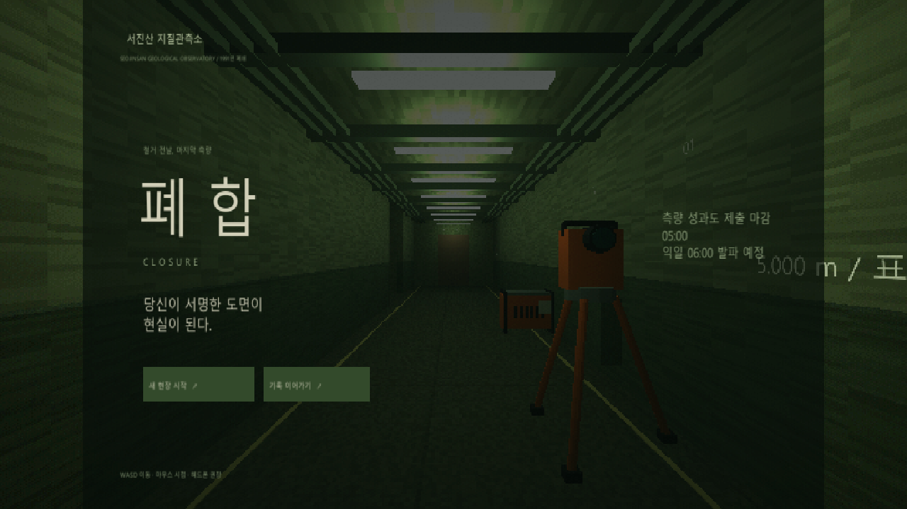

# 폐합 · CLOSURE

철거 전날 하룻밤, 폐쇄된 지질관측소를 측량하는 1인칭 미스터리 게임의 첫 플레이 버전입니다.

## 지금 플레이

**브라우저 실행판:** `폐합_실행.html`을 Chrome 또는 Edge로 여세요. 파일 하나에 3D 엔진, 블렌더 소품, 화면과 소리가 모두 포함되어 있어 인터넷이나 별도 설치 없이 실행됩니다. 브라우저에서 파일을 여는 대신 코드가 보이면 파일을 브라우저 창으로 끌어 놓으세요.

**Windows 실행판:** 아래 Unity 원본 안내에 따라 `CLOSURE → Windows 실행 파일 빌드`를 실행하면 `Unity/Builds/Windows/Closure.exe`가 생성됩니다. 별도로 제공된 `폐합_Windows.zip`을 가지고 있다면 전체 압축을 해제하고 `Closure.exe`를 실행하세요. Unity 에디터 없이 실행되며, `Closure_Data`, `UnityPlayer.dll` 등 같은 폴더의 파일을 함께 보관해야 합니다.

이 저장소에는 Unity·브라우저 소스, 블렌더 편집 원본과 브라우저 실행 HTML이 들어 있습니다. Windows 빌드 바이너리, Unity 캐시와 임시 검증 캡처는 Git에서 제외합니다.

이 버전은 **전체 흐름을 검증하는 단축 프로토타입**입니다. 3~4시간 분량의 상용 완성작은 아닙니다. 실제 플레이 시간은 탐색과 재측정 횟수에 따라 달라집니다.

## 조작

| 입력 | 동작 |
|---|---|
| WASD / Shift | 이동 / 빠르게 걷기 |
| 화면 클릭 + 마우스 | 시점 회전. ESC로 마우스 해제 |
| 방향키 좌우 | 마우스 잠금 없이 시점 회전 |
| P | 신규 기준점 설치 / 회수 |
| Q | 확인한 K점과 설치한 P점 사이 전환 |
| Space | 장비에서 선택한 대상 측정 |
| E | 가까운 기준점 채택 / 기록 조사 / 충전 / 구역 이동 |
| Tab | 야장 / 원본 기록 / 의심 표시 / 판정 |
| R | 감독관에게 질문. 10분 소모, 도움 이력 기록 |
| F | 손전등 |
| ESC | 작업 중지 메뉴 |

기존 K점은 각 구역의 끝벽 왼쪽, 충전함은 입구 왼쪽, 1991년 기록은 오른쪽 보조 기록실의 책상에 있습니다. Z1의 기록실은 이상 구간의 위치를 먼저 찾아야 조사할 수 있습니다. 측정 대상을 고르면 해당 표식으로 자동 조준합니다.

## 구현 내용

- 지상 작업부터 시작하는 8개 지하 구역과 최종 서명.
- Z1: P 기준 41.200m, K 기준 24.600m. 04·06·05번 구간을 비교하는 이분 탐색. 실제 복도 길이 41.2m, 길어진 여섯 번째 구간.
- Z2~Z7: 고저차, 교회법, 중복 ID, 추가된 표식, 부분 폐합, 마지막 야장.
- 기준점 설치·회수, 배터리·충전·행동 시간, 수치로 드러나지 않는 불안정도.
- 불변 측정 원본과 수동 의심 표시, K/P 채택 또는 보류, 도움 기록.
- 수집 기록, 미확인 공간 U-1~U-6, 방문한 구역 재조사.
- 모든 U 공간을 거쳐 K-01로 돌아오는 최종 폐합과 A~E 결말.
- 05:00에 조사 중단 후 서명 선택을 유지하는 마감 처리.
- 낮은 해상도의 3D 화면, 선명한 장비·야장 UI, 안개·형광등·손전등, 환경음.
- 자동 저장 / 이어하기 / 성과도 텍스트 파일 보관.

시계는 주요 구역 전환에서 압축 진행합니다. 야장 열람 중에는 시간이 흐르지 않습니다. 재방문은 야장의 **수집 기록 → 현장 재방문**에서 선택합니다.

브라우저 자동 저장은 브라우저와 파일 위치에 따라 달라집니다. 실행 파일의 위치를 바꾸거나 다른 브라우저를 쓰면 저장 기록이 이어지지 않을 수 있습니다.

## Unity 원본

`Unity` 폴더를 Unity Hub에서 프로젝트로 추가하세요. 실제 검증·빌드에 사용한 에디터는 **Unity 6.6 (6000.6.5f1)**, URP 17.6, Input System 1.19, uGUI 2.6입니다. 첫 패키지 설치에는 인터넷이 필요합니다. CLI 연동용 `com.unity.pipeline` 0.8.0-exp.1도 포함되어 있습니다.

1. 프로젝트를 열면 Editor 스크립트가 URP 자산, 블렌더 소품 프리팹, `Assets/Scenes/Main.unity`를 생성합니다.
2. 입력 시스템 활성화에 따른 에디터 재시작 요청이 표시되면 재시작합니다.
3. `Main` 씬에서 Play를 누릅니다. 메뉴 `CLOSURE → 프로젝트 설정 및 메인 씬 열기`로 설정을 다시 실행할 수 있습니다.
4. `CLOSURE → Windows 실행 파일 빌드`는 `Builds/Windows/Closure.exe`를 생성합니다.

Unity와 브라우저는 같은 측정 테이블·기록·결말 데이터를 사용합니다. Unity는 C# 런타임, CharacterController, uGUI, RenderTexture, URP 구성을 포함합니다. Unity UI는 기본 검증용이며 브라우저판과 시각적으로 완전히 같지는 않습니다.

Unity CLI로 실제 에디터에서 임포트와 컴파일, 플레이 모드의 프레임 진행, 원본 측정 기록, 야장 UI, 전 구역 생성, 최종 폐합과 D 엔딩을 검증했습니다. Windows 64비트 빌드가 성공했으며 오류는 0건입니다. 생성된 실행 파일도 별도 프로세스로 시작하여 시작 단계의 예외가 없는 것을 확인했습니다.

빌드 경고 1건은 에디터 연동용 Pipeline이 플레이어에서 비활성화된다는 안내입니다. 배포 게임에서 에디터 제어 서버는 실행되지 않습니다. 세부 빌드 결과는 `Unity_빌드결과.json`에 있습니다.

## 블렌더 자산

연결된 Blender 5.2에서 직접 제작한 삼각대 측량기, 기록 보관함, 현장 발전기를 사용했습니다.

- `ObservatoryAssets.blend`: 편집 원본. `CLOSURE_GameAssets` 컬렉션.
- `browser/observatory.glb`: 브라우저용 소품.
- `Unity/Assets/Art/Observatory.fbx`: Unity용 소품.

기존 블렌더 장면의 기본 오브젝트는 삭제하지 않았습니다. 게임 소품은 별도 컬렉션으로 추가했습니다.

## 검증과 현재 범위

브라우저 핵심 규칙 자동 검증 17개를 통과했습니다. 측정 조건, 두 기준의 차이, 이분 탐색, 원본 보존, 배터리·시간, 재방문, 전체 8구역 경로, 진 엔딩 폐합, 잘못된 순서, 5개 결말, 마감과 저장 검증을 포함합니다. `node --test browser/core.test.js`로 다시 실행할 수 있습니다.

실제 브라우저에서 지상 작업, 야장 기록, 저장 복원, 복도 이동, K-12 채택과 24.600/41.200의 비교, 의심 표시·구간 판정, 화면을 확인했습니다. 자동 검증은 사람이 모든 구역을 플레이한 사용성 검증을 대체하지 않습니다.

Unity C#의 순수 측량 규칙도 별도의 수학 함수 대체 구현으로 컴파일하여 8구역 → U 공간 6곳 → D 엔딩까지 검증했습니다. `tools/check-unity-core.ps1`로 실행할 수 있습니다. 이 검증에는 Unity의 렌더링·입력·uGUI·에디터 API가 포함되지 않습니다.

별도로 실제 Unity 플레이 모드에서 27개 관측을 거쳐 7개 조사 구역, 최종 성과도 구역, U 공간 6곳, D 엔딩까지 진행했습니다. 이 과정의 콘솔 예외는 0건이고, 프레임 카운터가 실제로 증가하는 것도 확인했습니다. 이는 조작 API를 통한 자동 검증이며, 사람이 전 구역을 이동하며 플레이한 사용성 테스트는 후속 검증입니다.

구역들은 공통 관측소 모듈을 변형한 초기 레벨입니다. 긴 분량의 독립적인 레벨 설계, 패드 조작, 녹음 대사, 세밀한 접근성 설정, 상용 수준의 연출·성능 조정은 후속 작업입니다. 교회법과 수준측량은 계산을 장비가 처리하는 단축 퍼즐입니다.

브라우저 엔진은 Three.js(MIT)를 사용합니다. 라이선스는 `browser/THREE-LICENSE.txt`에 포함되어 있습니다. 실행판에는 추적 코드, 외부 데이터 전송, 결제 기능이 없습니다.

## 브라우저 원본 수정 후 다시 빌드

Node.js가 설치된 환경에서 이 폴더를 열고 `npm install`, `npm run build`를 실행합니다. `npm test`로 핵심 규칙을 검증합니다. `browser/data.js`는 구역별 측정 테이블과 이야기, `core.js`는 측량 규칙, `world.js`는 3D 공간, `game.js`는 입력과 야장 UI입니다. 빌드하면 실행 HTML과 Unity용 JSON 데이터가 함께 갱신됩니다.
